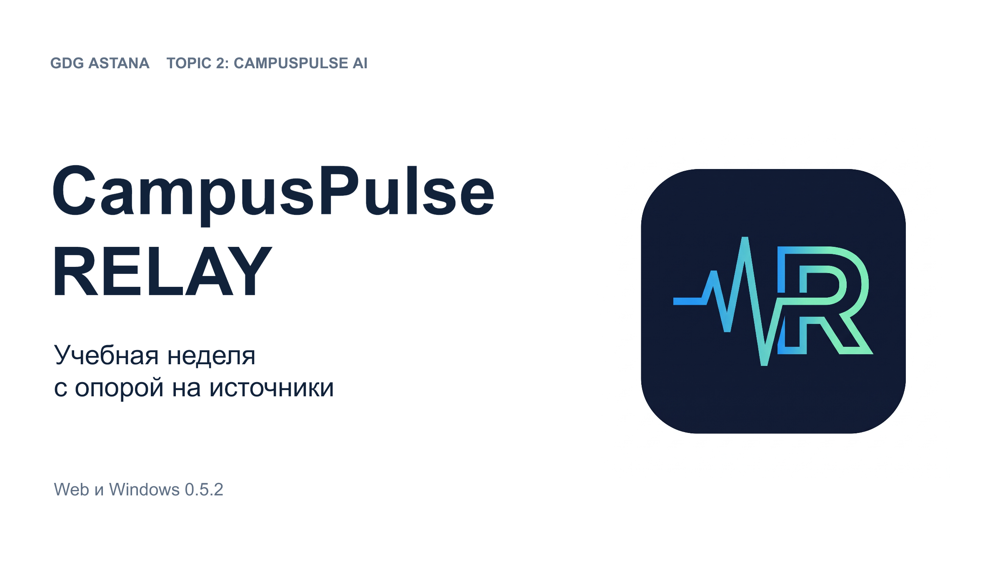
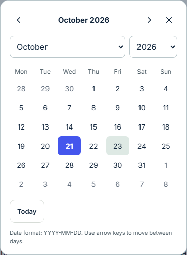
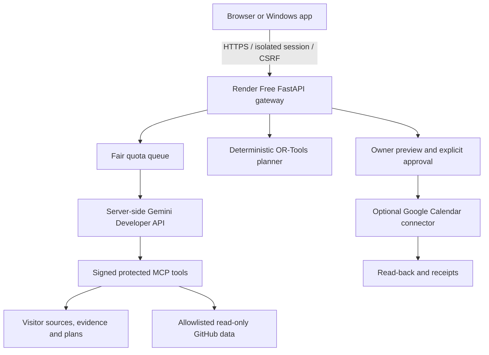

# CampusPulse RELAY

**Your week. Back in balance.** A student workspace that connects cited coursework, realistic study plans and explicitly approved actions.

Built for **GDG Astana — Topic 2: CampusPulse AI**. Current application version: **0.5.2**.

[Open the web app](https://campuspulse-relay-demo.onrender.com/) · [Download Windows](https://github.com/NuraliKuzhagaliev/campuspulse-relay-demo/releases/latest) · [Sample documents](https://campuspulse-relay-demo.onrender.com/samples/) · [Independent test plan in Russian](docs/independent_website_test_ru.txt) · [Judge quickstart](docs/final_judge_guide.md)

> The public app uses real **Gemini Developer API and protected MCP tools on Render Free**. Visitors need no invitation, RELAY account, Google login or personal API key for documents and questions. Google Calendar is a separate voluntary connection. **Managed Vertex AI Agent Engine has not been deployed**: the original managed-GCP criterion remains unmet, and an official waiver for this alternative architecture has not been established. `NON_GCP_READY=false` while the remaining Calendar and physical Windows acceptance gates are open.

## Presentation 0.5.2

[Editable PowerPoint, 14 slides](https://github.com/NuraliKuzhagaliev/campuspulse-relay-demo/releases/download/v0.5.2/CampusPulse-RELAY-0.5.2-design-r2.pptx) · [PDF for presenting](https://github.com/NuraliKuzhagaliev/campuspulse-relay-demo/releases/download/v0.5.2/CampusPulse-RELAY-0.5.2-design-r2.pdf)

The Russian deck uses the original product logo, actual 0.5.2 interface captures, the five core enhancements and current architecture. It labels historical real AI results, illustrative Calendar screenshots and remaining acceptance gates separately. Text and three tables remain editable in PowerPoint. The PDF contains high-resolution slide renders. Previous decks remain available as dated snapshots.



## Start in the browser

1. Open the [public HTTPS site](https://campuspulse-relay-demo.onrender.com/) and choose **Use my own data**. A private temporary visitor workspace is created automatically. **Open example** uses a separate, explicitly illustrative workspace.
2. Upload a permitted text PDF, Markdown, TXT or ICS file. Inspect the original page quotations and source version. For prose or table documents, use **Propose with Gemini** after reading and accepting the displayed free-service processing conditions.
3. Review each proposed assignment and confirm its fields individually. Missing information stays unknown. If sources disagree, compare the quotations and explicitly choose the fact to use.
4. Set the workspace timezone, date range, available days and study hours; save the planning context. Generate a plan, compare what-if alternatives and inspect the next-action packet or Preflight.
5. Record actual work and explicitly remaining effort separately. Before leaving, export a **Workspace Passport** under **Evidence → Progress & continuity**.

The service may take time to wake up. Free Gemini quotas are finite and shared: the queue can wait, back off or return a useful failure. No unlimited free requests or guaranteed response latency is promised. Use permitted synthetic or non-sensitive material only; the UI explains the free-service age, region and processing conditions.

## What RELAY does

| Capability | Behavior and boundaries |
|---|---|
| Evidence-backed deadlines / Conflict Inbox (F1) | Stores original quotations, page, source version and conflicting facts; the student confirms each interpretation. |
| Feasibility / What-if Recovery (F2) | Deterministic OR-Tools scheduling respects availability, deadlines, busy intervals and dependencies. It reports infeasibility instead of inventing time. |
| Change Radar (F3) | Performs allowlisted, read-only GitHub observations while the server is awake. Version changes and failures enter the operation history; a closed browser does not stop an awake server. Free-host sleep can interrupt polling. |
| Approved Actions / Verified Receipts (F4) | Separates exact preview, owner approval, execution and read-back. Immutable operation IDs and stored receipts protect retries; undo is a separate owner action. Illustrative and real Calendar modes remain distinct. |
| Rubric-to-Next-Action Packets (F5) | Links the next concrete work step to an original criterion, dependencies and evidence gaps. A proposed step does not prove learning, completion or submission. |
| Minimal Rescue | Compares additional availability explicitly offered by the student; it does not move a real deadline or silently occupy forbidden time. |
| Submission Preflight / Judge Challenge | Checks observable draft structure against cited requirements and exposes evidence/tool/plan traces. It does not grade semantic correctness or submit work. |
| Progress & Remaining Work | Preserves actual time logs and explicit remaining work separately. Logging 45 minutes does not automatically subtract 45 from a source estimate or a reported 95-minute remainder. |
| Clarify First | Compares the scheduling impact of unresolved alternatives before the student chooses an interpretation. |
| Handoff Radar | Observes a permitted existing public pull request. A merge is external evidence, not automatic coursework completion or Calendar permission. |
| Workspace Passport | Previews an archive and restores it as a fresh copy; the original workspace remains intact. Credentials, Google consent, executable approvals and operation journals are not transferred. |

The five core enhancements are **locally implemented**. Real Calendar acceptance and full enhancement-level Gemini acceptance are tracked separately in the [requirement ledger](REQUIREMENTS.md) and [dated evidence](docs/final_integration_ledger.md).

## Languages, dates and timezones

The visible language choices are **EN / RU / KZ**. The Kazakh locale uses the standard internal language code `kk` and locale `kk-KZ`; `KZ` is the requested UI label.

Workspace settings offer exactly three choices in both Planning context and Connections:

| Display | Stored IANA value | 18:00 in this zone, October 2026 |
|---|---|---|
| Kazakhstan / Казахстан / Қазақстан | `Asia/Almaty` | 13:00 UTC |
| Moscow / Москва / Мәскеу · MSK | `Europe/Moscow` | 15:00 UTC |
| UTC | `UTC` | 18:00 UTC |

Both settings APIs reject arbitrary timezone strings and other zones. Original source timestamps and explicit source offsets are preserved; a workspace display zone is not evidence that a document used that zone. Old Passport archives preview any necessary workspace-zone conversion before the student restores a new copy; their absolute availability timestamps remain unchanged.

The calendar is rendered by RELAY with the selected application locale. **October / октябрь / қазан**, weekday names and calendar controls follow EN/RU/KZ even when Windows or the browser uses another language. Dates are entered as `YYYY-MM-DD`; clocks use unambiguous 24-hour `HH:mm`. Native Windows file Open/Save dialogs retain the operating system language; the in-app date picker follows RELAY. Study windows use half-hour choices. A deadline with an unknown time must remain unknown until explicitly completed.



Original document titles and quotations, repository identifiers, Calendar IDs and expandable original technical diagnostics remain verbatim. Their source language is not silently rewritten.

## Windows: download and update

- [Latest Windows installer](https://github.com/NuraliKuzhagaliev/campuspulse-relay-demo/releases/latest/download/CampusPulse-RELAY-Windows-Setup.exe)
- [Latest portable Windows app](https://github.com/NuraliKuzhagaliev/campuspulse-relay-demo/releases/latest/download/CampusPulse-RELAY-Windows-Portable.exe)
- [All latest release files, D-drive launchers and checksums](https://github.com/NuraliKuzhagaliev/campuspulse-relay-demo/releases/latest)

The **Windows app** link in the web header and the download section in Connections point to the latest release, rather than an old version-specific installer.

This project's Windows distribution requires **drive D:**. Download the executable and its matching `Install-D.cmd` or `Launch-Portable-D.cmd` into the same folder on D:. The launchers put temporary extraction files on D:. Close RELAY manually, then run the matching launcher. The installer uses:

```text
D:\projects\CampusPulseRELAY\installed\CampusPulse RELAY
```

The D-only installer replaces program files and preserves existing profiles. It does not start the app automatically. Reopen the installed D-drive executable after installation. The portable launcher also uses D: for its temporary extraction. The app's default local profile is under `D:\projects\CampusPulseRELAY\.local\desktop`; a dedicated verification profile can be supplied with `RELAY_DESKTOP_DATA`.

The Windows app connects to the same public HTTPS backend by default. It adds native selected-file import, Passport save dialogs and notifications. Files are selected explicitly; RELAY does not index the drive. Native picker appearance, successful import, notification visibility and notification click/focus are separate acceptance results.

The binaries are unsigned. Check the release origin and `SHA256SUMS.txt`; do not disable system protection or run an untrusted copy. Do not confuse a completed build with a verified installation. After an earlier installer defect, an obsolete C-drive copy may coexist with the D-drive installation; update the D copy and preserve its profiles before manually removing an unwanted older installation.

## Connect your own Google Calendar — optional

Documents, questions and local planning work without Google. Each visitor uses their **own** account and app-created calendar; no shared project calendar is assigned to visitors.

1. Prepare the intended personal workspace first. Importing a Passport later switches to a new workspace and does not carry Google consent.
2. In **Connections → Study calendar**, choose **Connect Google in system browser**. Start and finish the flow in the same browser/profile, within the displayed expiry. Read and accept the app-created-calendars permission yourself; do not copy another person's OAuth or callback URL.
3. Create a separate study calendar once, or recover your existing app-created calendar by its ID from Google Calendar settings. After verification, **select its button from the authorized list**.
4. Check the selected target and the real-connection indicator. `configured=true`, `connected=true` and `calendar_live=true` mean configuration, consent and target selection; they do not prove an event was written.
5. Generate a plan and inspect the exact live Calendar preview: calendar ID, operation count, titles, dates, times and timezone. Only the owner approves the exact real write.
6. Require a verified receipt and fresh matching read-back; open Google Calendar and inspect the event itself. A read-back alone is not a replay test. Retry only the same approved request when checking idempotency, and inspect unknown outcomes before any new write.
7. Undoing an unchanged owned test event is a separate deliberate action. Disconnecting Calendar does not delete existing events. Revocation and deletion are reported separately.

A 404 while recovering a calendar can mean the ID, account or app-created scope does not grant access. Verify the actual ID/account; do not create repeated calendars or broaden permissions blindly. Expired workspaces require fresh consent in the new workspace; Google Console setup does not need to be repeated.

Detailed independent steps and a one-event synthetic fixture: [website test plan](docs/independent_website_test_ru.txt), [Calendar guide](docs/independent_tester_calendar_ru.txt), [calendar-readback-check.md](fixtures/calendar-readback-check.md).

## Real, illustrative and pending — how to read the UI

| Status | Meaning |
|---|---|
| Gemini Developer API / server-side MCP | Actual model/tool route. Inspect the observed tools and final `complete`, `partial` or `failed` outcome. A repaired call can leave the overall run partial. |
| Illustrative workspace / local Calendar adapter | Synthetic coursework and simulated external Calendar actions. Their receipts do not prove Google writes. |
| Google connected | Owner consent is stored for this temporary workspace; a target may still need selection. |
| Live Calendar / verified read-back | Real connector and an observed event result for the selected target; acceptance still depends on the exact operation being checked. |
| Managed GCP disabled / criterion unmet | Prepared Agent Engine scripts exist but no managed deployment or official architectural waiver is claimed. |

A deterministic plan is not an AI response. A source quote supports an interpretation, not the truth of every generated conclusion. Timer duration is not proof of attention, learning, submission or completion.

## Architecture and privacy



React/TypeScript/Vite provides the interface; FastAPI owns sessions and validation; FastMCP exposes authenticated tools; OR-Tools handles scheduling; SQLite stores isolated workspace records; Electron provides the Windows shell. Gemini and Google credentials stay server-side. Windows configuration helpers use current-user DPAPI for local secrets on D:.

Server controls include capability-bound temporary sessions, per-tenant authorization, CSRF/origin checks, a bounded fair queue, upload/parser limits, typed upstream failures and narrowly validated Electron IPC. Internal MCP/admin/test operations are not public browser capabilities. Public AI cannot authorize Calendar writes or consume private Calendar payloads.

**Persistence is temporary.** A workspace expires after two hours and can reset sooner after hosting sleep, restart or deploy. Documents, conversation history, queued work and Google connections can disappear. Export a Passport before leaving; it carries selected coursework/progress, not a durable server backup, AI operation journal or credentials. After an unknown external result, inspect the receipt and actual Calendar before retrying.

No personal spending, paid upgrade, paid fallback or personal GCP billing activation is authorized. Free quotas remain finite. Agent Engine/IAM/cloud-state scripts are retained as a disabled additional integration.

## Document support and examples

Supported imports: **text PDF, Markdown, TXT and ICS**, up to **2 MiB** each. PDFs are limited to **100 pages / 250,000 extracted characters** and parsed in a bounded subprocess. No OCR, scanned-image reading or arbitrary disk access is promised. The public demo accepts at most 12 sources per workspace, including loaded examples.

[The sample page](https://campuspulse-relay-demo.onrender.com/samples/) includes 13 synthetic files, EN/RU/Kazakh explanations and expected results:

- Original/revised deadlines and same-title assignments in different courses.
- EN/RU/Kazakh prose; missing and ambiguous data.
- A two-page continued brief and a table PDF.
- An ICS busy-time snapshot, a Preflight draft and a Passport archive.

Use `09-workspace.relay.json` only through **Workspace Passport**; use `10-prism-draft.md` as a Preflight draft. They are not ordinary source imports. Exact source effort 45/75 minutes remains distinct from solver allocation 60/90 minutes.

## Run locally on D:

Prerequisites: an existing **Node.js 22** runtime, **Python 3.13**, Git and sufficient free space on D:. Project dependencies, environments, caches, temporary files and builds stay on D:; system runtimes may be preinstalled.

```powershell
Set-Location D:\projects
git clone https://github.com/NuraliKuzhagaliev/campuspulse-relay-demo.git CampusPulseRELAY
Set-Location D:\projects\CampusPulseRELAY
powershell.exe -NoProfile -ExecutionPolicy Bypass -File .\scripts\bootstrap.ps1
powershell.exe -NoProfile -ExecutionPolicy Bypass -File .\scripts\dev.ps1
```

Open `http://127.0.0.1:8000/`. A fresh local setup is illustrative and does not impersonate a successful Gemini/Google connection. The complete web ZIP can instead be extracted on D: and started with its `scripts/run-web-bundle.ps1`; it includes the React build and Python gateway.

For builds and tests, initialize the D-drive environment in the same PowerShell process:

```powershell
. .\scripts\env.ps1
npm ci
npm run build
.\.venv\Scripts\python.exe -m pytest -q
node --test tests/desktop_policy.test.cjs
npm run package:win
```

Real server setup uses `requirements.cloud.txt`, the existing `scripts/configure-gemini-free.ps1` and server configuration described in [the deployment runbook](docs/final_integration_ledger.md). Never put keys in the frontend, chat, README or Git. The historical `alternative_live` mode name means the current Render/Gemini primary route; it does not activate managed GCP. Optional Google consent needs an owner-configured OAuth client and a working same-browser HTTPS redirect. Existing production secrets must not be copied into a public sample.

## Repository map

| Path | Purpose |
|---|---|
| `src/` | React interface, locale dictionaries, app-owned calendar and timeline |
| `relay/` | FastAPI gateway, protected MCP, providers, evidence, planner, operations and Passport |
| `desktop/` | Electron main/preload, narrow IPC policy, logo and D-only NSIS installer |
| `infra/` | Actual alternative-host Docker entrypoint and disabled optional managed-cloud preparation |
| `public/samples/`, `fixtures/` | Synthetic examples and explicit acceptance inputs |
| `tests/` | Deterministic regressions; simulated-provider load tests are labelled |
| `docs/evidence/` | Dated results with scope, commits and limitations |
| `release/manifest.json` | Current source/runtime IDs, acceptance status and artifact hashes |
| `release/versions/`, `submission/` | Preserved local sealed releases on D:; binary files are distributed through GitHub Releases |
| `.local/`, `.venv/`, `.env`, `installed/` | Private local state; excluded from Git |

## Verification and remaining acceptance

The evidence ledger distinguishes a successful local test, a real hosted Gemini/MCP turn, a Google event operation and a physical Windows check. It preserves partial/failed runs and earlier releases instead of replacing their meaning with a later build.

Version 0.5.2 is published on Render Free and [GitHub Releases](https://github.com/NuraliKuzhagaliev/campuspulse-relay-demo/releases/tag/v0.5.2), from source/runtime commit `0cb787885df570b4083d0b041e828e14394ed0f0`. Public verification used strict HTTPS and fresh visitors: 9 language/width states, 4 edge flows, real document upload/review/confirmation, planning, what-if, explicitly illustrative receipts and Passport restore. The latest installer and portable download links were checked against the published v0.5.2 assets; all 13 asset hashes match GitHub. Windows product version is 0.5.2.0; 16 packaged files match the source. No current-version physical installation is implied.

These locale/distribution rechecks made **zero new Gemini calls and zero real Google Calendar writes**. Their results are in [public deployment evidence](docs/evidence/public-deployment-0.5.2.json), [public locale evidence](docs/evidence/public-locale-0.5.2.json), [edge flows](docs/evidence/public-edges-0.5.2.json) and [download verification](docs/evidence/release-distribution-0.5.2.json). The subsequent documentation-only commit records observations; the runtime/tag/source ZIP remain at the exact commit above.

The latest local suite and language/date-picker evidence are recorded in `docs/evidence/locale-release-0.5.2.json`. The 100-session fairness/isolation test uses a **simulated provider with zero real Gemini calls**; actual protected MCP protocol is checked separately. Historical real hosted evidence includes own EN/RU/Kazakh prose, continued/table PDF and multi-turn isolation; it is not a claim of unlimited current quota.

Remaining external gates: owner-confirmed real Calendar preview/write/read-back/replay/undo/revocation, and installed-current-version native picker/Passport save/import/reopen/notification visibility/click-focus. Building or statically comparing an EXE does not pass those physical checks. Windows GUI control stopped through Escape remains stopped until the owner explicitly authorizes it again.

Original managed-GCP compliance remains unmet. Check [REQUIREMENTS.md](REQUIREMENTS.md), [BLOCKERS.md](BLOCKERS.md), [STATUS.md](STATUS.md), the [ledger](docs/final_integration_ledger.md) and release manifest for the precise scope.

## Быстрый старт по-русски

Откройте сайт → **Со своими данными** → импортируйте разрешённый документ → проверьте цитаты и подтвердите каждое задание → выберите один из трёх поясов, даты и часы → сохраните контекст → постройте план. Для Gemini прочитайте и примите показанные условия бесплатной обработки; собственный ключ и Google-вход не нужны.

**KZ — казахский язык интерфейса.** Названия месяцев и кнопки календаря следуют языку приложения, а исходные цитаты сохраняются на языке документа. Google Calendar подключается по желанию владельца: согласие, выбор отдельного календаря, точный предпросмотр, отдельное одобрение и проверка результата. Чужой Calendar ID использовать не нужно.

Для Windows скачайте установщик и соответствующий `.cmd` со страницы последнего выпуска, поместите оба файла на D: и запустите `.cmd`. Старые профили сохраняются. Перед сбросом временного веб-сеанса экспортируйте Passport. Полная [инструкция независимому проверяющему](docs/independent_website_test_ru.txt) включает образцы, Calendar и форму отчёта.

## License

[MIT](LICENSE). Synthetic samples are clearly marked. Product and verification statements are limited to their recorded evidence.
