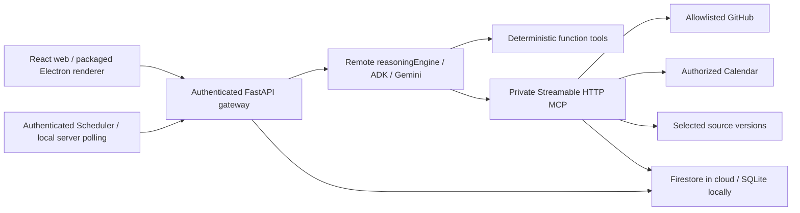

# Architecture and data flow

0.3.0 adds focused domain services `progress.py`, `clarify.py`, `handoff.py` and `passport.py`, used by the same FastAPI/web/Electron boundaries. The PR observation service is also the genuine authenticated MCP tool implementation. `Continuity.tsx` contains focused feature panels rather than expanding the main week's intertwined branches. There is no new stack or paid service.

`Store.atomic` uses `BEGIN IMMEDIATE` and a tenant-scoped transaction interface for multi-record progress commands, history, invalidation and portable copy commit. A bound additions revision plus source/settings/decision/progress/gate fingerprints protects comparisons, plan previews and approvals. Idempotency keys compare command bodies before optimistic revision checks; old IDs cannot change payload. Portable commit generates a fresh server namespace and source/fact references, never trusts imported tenant authority. Source identity migrations/history from0.2.1 remain intact. New Firestore transactions fail closed until a real integration test.

Clarification runs bounded pure branches off the API event loop with one job/workspace and two global jobs; model-build guards and solver deadlines/cancellation keep unknown outcomes explicit. PR observations use a bounded shared immutable cache/ETag/backoff and no arbitrary fetch URL. Native restore/save adds exact purpose/routes, keeps sandbox/context isolation and the corrected academic import allowlist, and verifies D: resolved save destinations. No restoration or progress operation can authorize Calendar; that remains a fresh independent preview/approval/journal boundary.

Cloud components in this diagram are **implemented deployment targets, not verified running resources**. The local gateway serves real HTTP requests and persists state in SQLite. A model request is refused when `RELAY_AGENT_RESOURCE` is absent. There is no local-model or gateway-hosted-agent success fallback.

`RelayRuntime` is deployed with `client.agent_engines.create`; its `query` method creates an ADK agent for the verified scope and dynamically selects custom MCP and deterministic function tools. Google Gen AI performs inference. The installed Vertex client is a compatibility entry point and emits a migration warning; no deprecated `vertexai.generative_models` inference code is used.

Identity is server-verified Google identity in cloud mode; a random HttpOnly local session identifies an explicitly illustrative development workspace. The gateway signs short-lived audience-bound workspace context. Tool schemas contain no `user_id` or arbitrary `calendar_id`. Cloud Run additionally requires service identity on MCP. The ADK header provider fetches a machine ID token for fresh MCP sessions. Token renewal and restart are designed but not cloud-tested.

OAuth uses the system browser, state, PKCE, verified ID-token subject, encrypted refresh credentials, and explicit one-use desktop pairing. Calendar selection is checked against that user's authorized list. Live OAuth/consent/revocation testing and isolated judge access remain blocked. A service account never automatically acquires personal Calendar access.

State: workspace settings/connections, source versions, exact extracted facts, task overrides, conflict decisions, plan versions/blocks, ordered run events, immutable previews, approvals, operation journal, receipts and sync cursors. SQLite provides transactions locally; Firestore provides create-once and compare-and-set transactions in cloud mode. Firestore, service IAM and cloud concurrency have not been integration-tested.

Scheduling consumes validated 30-minute units, deadlines, windows, busy intervals, dependencies, daily caps, baseline blocks and pins. CP-SAT returns a status; an independent interval validator checks the result. Incomplete allocation is never accepted as feasible. What-if scenarios neither replace the baseline nor write to Calendar.

Actions are immutable previews bound to identity, target, source versions, settings/overrides, plan and action digest. Before applying, the backend re-reads Calendar and source preconditions. Each operation has a deterministic Calendar ID and durable journal entry. Retries reconcile unknown outcomes. Recovery previews distinguish create/keep/delete; edited/unowned events are preserved. Undo removes only unchanged events created by that receipt; restoring deleted prior blocks requires a fresh preview, which is disclosed.

Events use persisted sequence IDs and authenticated polling. The inspector shows short operational summaries, actual calls, durations and failures. It never exposes hidden chain-of-thought or fabricated progress.
